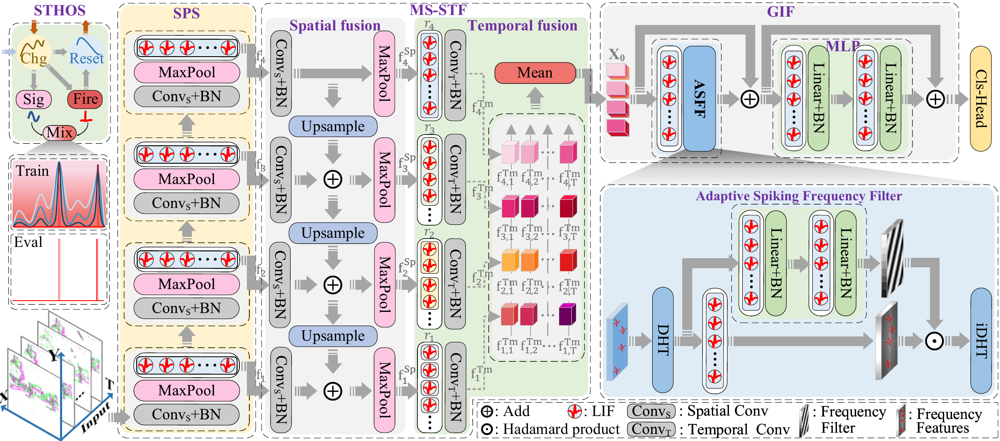

# FAME-SNN: Frequency Aware Multi-scale Enhanced Spiking Neural Network

FAME-SNN combines **Multi-scale Spatial-Temporal Fusion (MS-STF)**, **Global Information Fusion (GIF)**, and the **STHOS training strategy** for image and event classification.

<p align="center">
  
</p>

[View the architecture as a vector PDF](./imgs/model.pdf).

## Model components

- **MS-STF** fuses spatial features and integrates temporal features over contiguous windows of different lengths. Event models use window counts `[8, 4, 2, 1]`: at `T=16`, their integration lengths are `[2, 4, 8, 16]`. `split_contiguous_windows` and `restore_temporal_order` preserve the original frame order.
- **GIF** contains the Adaptive Spiking Frequency Filter (ASFF) and the residual MLP, including the existing BNinitial initialization. Hartley transform, inverse transform, and frequency reflection are encapsulated in `hartley2` in each `model.py`.
- **STHOS** is implemented by the dataset-local `STHOS/` code and the training schedule. Configure its duration using the `STHOS` YAML field or the ImageNet `--STHOS` argument.

The temporal-window and Hartley helpers are parameter-free. The model files retain the parameter names and shapes of the source checkout; use the same dataset, depth, width, and other structural settings when loading a trained checkpoint.

## Repository layout

Each dataset keeps its own model, training entry point, and STHOS implementation.

| Dataset | Directory | Training entry | Default configuration |
| --- | --- | --- | --- |
| CIFAR-10 | `CIFAR10/` | `train.py` | `cifar10.yml` |
| CIFAR-100 | `CIFAR100/` | `train.py` | `cifar100.yml` |
| CIFAR10-DVS | `CIFAR10-DVS/` | `train.py` | `cifar10dvs4221.yml` |
| DVS128 Gesture | `DVS128-gesture/` | `train.py` | `dvs128.yml` |
| HMDB51-DVS | `HMDB51-DVS/` | `train.py` | `HMDB51DVS.yml` |
| UCF101-DVS | `UCF101-DVS/` | `train.py` | `UCF101DVS.yml` |
| Tiny-ImageNet | `Tiny-ImageNet/` | `train.py` | `Tiny-Imagenet.yml` |
| ImageNet | `ImageNet/` | `train_qk.py` | Command-line arguments |

## Installation

The reference runtime is **Linux, Python 3.8, PyTorch 2.0.0, torchvision 0.15.1, and CUDA 11.8**. The CuPy neuron backend requires an NVIDIA GPU and a compatible driver.

```bash
conda create -n fame-snn python=3.8 -y
conda activate fame-snn
python -m pip install torch==2.0.0 torchvision==0.15.1 --index-url https://download.pytorch.org/whl/cu118
python -m pip install -r requirements.txt
```

Native AMP is supported. Apex, Weights & Biases, and the optional legacy energy-profiling package are not required for the default training paths.

## Data preparation

Datasets and pretrained weights are obtained separately. Run commands from the corresponding dataset directory. YAML data and cache paths default to `./data`; set them in the YAML or override them on the command line.

- **CIFAR-10 / CIFAR-100:** use the torchvision dataset root. Their training entries request the standard datasets through timm.
- **CIFAR10-DVS / DVS128 Gesture:** use the dataset root expected by SpikingJelly. The existing loader constructs frames with `frames_number=T` and `split_by='number'`. CIFAR10-DVS keeps its existing class-wise split; Gesture uses the dataset's train/test splits.
- **ImageNet / Tiny-ImageNet:** provide class-folder `train/` and `val/` directories. Tiny-ImageNet validation images must be arranged into class folders; ImageNet expects `data_path/train/<class>/` and `data_path/val/<class>/`.
- **HMDB51-DVS:** the current training path requires existing Tonic `DiskCachedDataset` frame caches. Put `train_cache_16/` and `test_cache_16/` under `CACHE_ROOT` for the T=16 configuration. Changing T requires matching caches `train_cache_<T>/` and `test_cache_<T>/`.
- **UCF101-DVS:** use raw `train/` and `test/` event directories or existing Tonic frame caches. For T=8, cache folders are `train_cache_8/` and `test_cache_8/` under `CACHE_ROOT`. Raw events are preferred when both raw directories exist; otherwise the loader uses existing caches.

The event caches contain frame samples and labels in the format written by `tonic.DiskCachedDataset`. Their temporal binning and sample splits must match the intended experiment. The HMDB loader consumes these caches directly.

## Training

### YAML-based datasets

The seven `train.py` entries accept `-c CONFIG.yml`, `-data-dir PATH`, `--batch-size`, `--output`, and `--resume`. Command-line arguments override YAML defaults. A distributed batch size is the batch size **per GPU**.

For example, from the repository root:

```bash
cd CIFAR10
python -m torch.distributed.run --standalone --nproc_per_node=1 train.py \
  -c cifar10.yml -data-dir /path/to/cifar10 --output ./output
```

Use the dataset directory and configuration from the table for CIFAR-100, CIFAR10-DVS, DVS128 Gesture, or Tiny-ImageNet. Change `--nproc_per_node` to the number of GPUs for DDP. HMDB and UCF also accept `--cache-root PATH`.

### HMDB51-DVS: 2-384, T=16, eight GPUs

```bash
cd HMDB51-DVS
PYTHON=python3 CACHE_ROOT=/path/to/hmdb_caches OUTPUT_DIR=./output \
  bash run_hmdb_2_384_8gpu.sh
```

The script launches **one node with eight GPUs**, width 384, depth 2, T=16, batch size 8 per GPU (global batch 64), seed 42, and native AMP. It starts with an empty resume path. The YAML retains AdamP, learning rate 0.005, weight decay 0.9, 300 epochs, 20 warmup epochs, 10 cooldown epochs, and STHOS duration 100. The script overrides the YAML batch size of 32 with 8.

Available HMDB configurations also include `HMDB51DVS_T16_d2_dim256_bs24.yml` and `HMDB51DVS_T8_original.yml`. Their batch sizes and model settings remain specific to those configurations.

### UCF101-DVS: two nodes, eight GPUs per node

Start the following concurrently on two machines with identical code, configuration, and sample ordering. `MASTER_ADDR` is the address of node 0 reachable from both nodes.

```bash
# Node 0, from UCF101-DVS/
MASTER_ADDR=<node-0-address> CACHE_ROOT=/path/to/ucf_caches \
  OUTPUT_DIR=./output bash run.sh 0

# Node 1, from UCF101-DVS/
MASTER_ADDR=<node-0-address> CACHE_ROOT=/path/to/ucf_caches \
  OUTPUT_DIR=./output bash run.sh 1
```

This preserves the two-node, 16-GPU launch with batch size 32 per GPU (global batch 512), depth 2, width 384, T=8, and AMP. Defaults include AdamP, learning rate 0.005, weight decay 0.8, 300 epochs, and STHOS duration 100. Set `PYTHON`, `CONFIG`, `MASTER_PORT`, `PER_GPU_BATCH`, `VAL_PER_GPU_BATCH`, `WORKERS`, or `EXPERIMENT` as needed. For raw events, also set `DATA_DIR=/path/to/raw_ucf`. The network interface can be selected with `NCCL_SOCKET_IFNAME`; otherwise NCCL selects it automatically. If T changes, set `CACHE_TIME_STEP` and the training configuration to the same T.

A single-node UCF launch is also available through its training entry:

```bash
python -m torch.distributed.run --standalone --nproc_per_node=8 train.py \
  -c UCF101DVS.yml -data-dir '' --cache-root /path/to/ucf_caches \
  --output ./output --native-amp
```

### ImageNet

```bash
cd ImageNet
python -m torch.distributed.run --standalone --nproc_per_node=8 train_qk.py \
  --data_path /path/to/imagenet --output_dir ./output --log_dir ./output
```

ImageNet uses underscore-style arguments such as `--batch_size` and `--time_step`. Its preserved defaults include `FAMESNN_10_384`, T=4, batch size 14 per GPU, and gradient accumulation of 8. Set `--STHOS` to the duration chosen for the experiment; the preserved CLI default is 0. Run `python train_qk.py --help` for the complete configuration.

## Model scales and checkpoints

For YAML-based training, `dim` specifies width and `depths` specifies the number of GIF blocks. A scale such as **2-384** means `depths: 2` and `dim: 384`. When a YAML also contains `layer`, keep it consistent with `depths`; `--layer` alone does not replace `depths` supplied to the model factory. ImageNet selects its registered model with `--model`.

To resume YAML-based training, pass `--resume /path/to/checkpoint.pth.tar`; ImageNet uses `--resume /path/to/checkpoint.pth`. Checkpoints must match the dataset and model configuration. The release includes source code, configurations, and the architecture figure.

## Acknowledgments

Our codes are based on the official ImageNet example by [PyTorch](https://github.com/pytorch/examples), [pytorch-image-models (timm)](https://github.com/huggingface/pytorch-image-models) by Ross Wightman, and [SpikingJelly](https://github.com/fangwei123456/spikingjelly) by Wei Fang. ImageNet training utilities retain their original Meta/MAE source headers. Event loading also uses [Tonic](https://github.com/neuromorphs/tonic). Existing source copyright and attribution headers are preserved.
